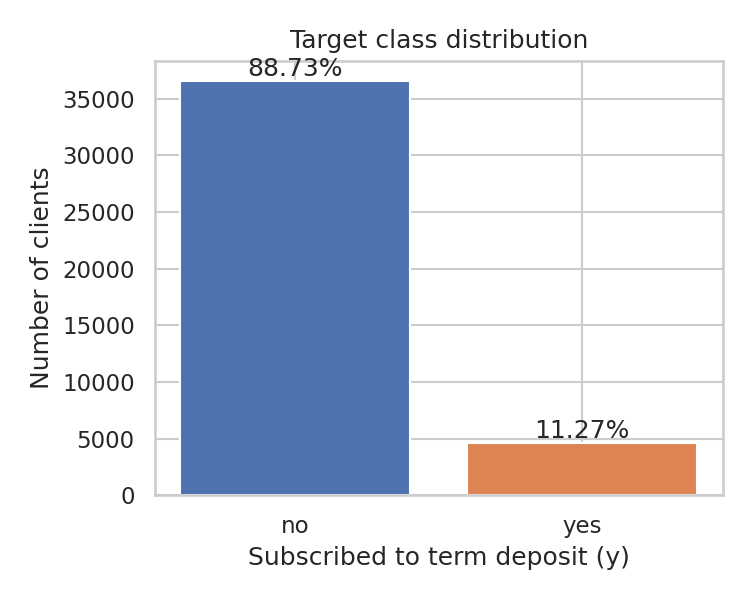
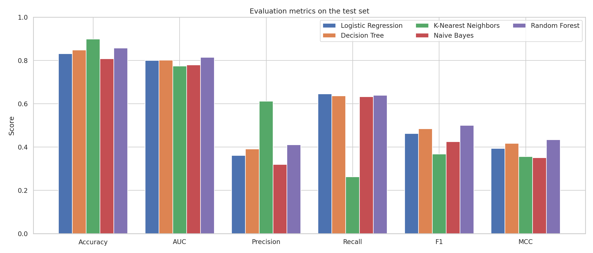
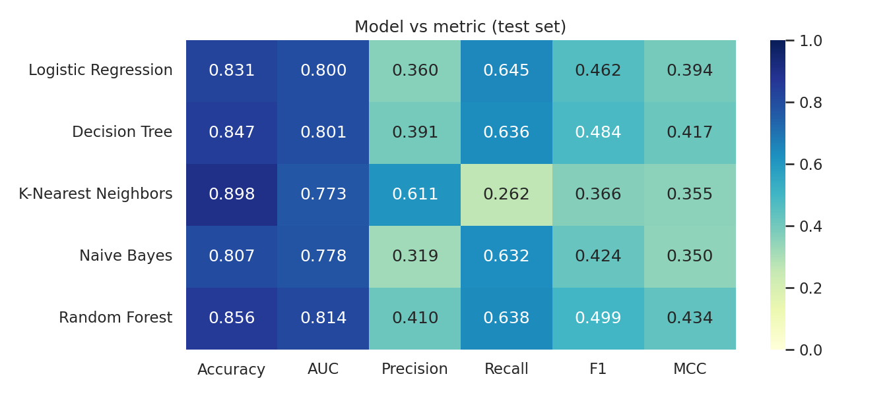
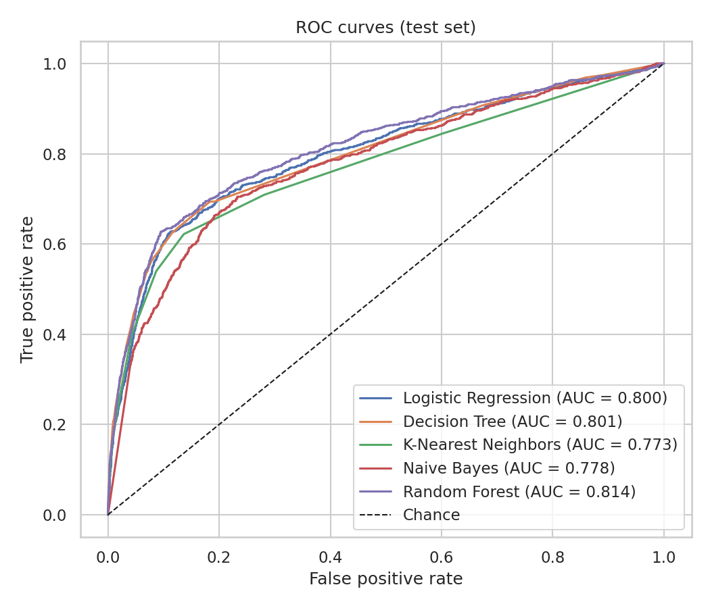
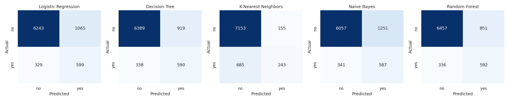

# Term Deposit Subscription Prediction (Bank Marketing)

Machine Learning - Assignment 2, M.Tech (AIML/DSE), BITS Pilani WILP

**Name:** MALLIPEDDI DATTA SAI  
**BITS ID:** 2026CT05139

## a. Problem statement

A Portuguese bank runs phone campaigns to sell term deposits. Most calls do not end in a subscription, so
calling every client is expensive. The task is to predict, from client details, campaign history and
economic indicators, whether a client will subscribe to a term deposit (`yes` / `no`). This is a binary
classification problem. Five classification models are trained on the same data and compared on six
evaluation metrics.

## b. Dataset description

| | |
|---|---|
| Dataset | Bank Marketing (`bank-additional-full.csv`) |
| Source | UCI Machine Learning Repository, https://archive.ics.uci.edu/dataset/222/bank+marketing |
| Instances | 41,188 (41,176 after removing 12 duplicate rows) |
| Features | 20 (10 numeric, 10 categorical) |
| Target | `y` - client subscribed to a term deposit (`yes` / `no`) |
| Missing values | 12,718 cells in 6 categorical columns, recorded as `unknown` |
| Class distribution | `no` 88.73%, `yes` 11.27% (about 7.9 : 1) |

**Why this dataset:** it is well above the minimum size, it mixes numeric and categorical features so both
encoding and scaling are needed, it has missing values and duplicates to handle, and the target is clearly
imbalanced, which makes the comparison of metrics meaningful.

**Feature types**

| Group | Features |
|---|---|
| Client (numeric) | `age` |
| Client (categorical) | `job`, `marital`, `education`, `default`, `housing`, `loan` |
| Last contact (categorical) | `contact`, `month`, `day_of_week` |
| Last contact (numeric) | `duration` |
| Campaign history (numeric) | `campaign`, `pdays`, `previous` |
| Campaign history (categorical) | `poutcome` |
| Economic context (numeric) | `emp.var.rate`, `cons.price.idx`, `cons.conf.idx`, `euribor3m`, `nr.employed` |

**Missing values per column:** `default` 20.87%, `education` 4.20%, `housing` 2.40%, `loan` 2.40%,
`job` 0.80%, `marital` 0.19%.

**Class distribution**



Always predicting `no` would already give 88.73% accuracy, so accuracy on its own says very little here.

## c. GitHub repository link

https://github.com/Dattu9/bank-marketing-classification

**Repository structure**

```
bank-marketing-classification/
|-- requirements.txt
|-- README.md
|-- test_data.csv                               hold-out test set (8,236 rows) used for all reported metrics
|-- data/
|   |-- bank-additional-full.csv                raw dataset from UCI
|-- model/
|   |-- bank_marketing_classification.ipynb     preprocessing, the five models, evaluation and plots
|-- results/
    |-- model_comparison.csv                    metrics table
    |-- train_vs_test.csv                       train vs test F1 and AUC
    |-- *.png                                   figures used in this README
```

**How to run**

```
pip install -r requirements.txt
jupyter notebook model/bank_marketing_classification.ipynb
```

Then choose *Kernel > Restart & Run All*. The notebook reads `data/bank-additional-full.csv`, and writes
`test_data.csv` and everything in `results/`. A fixed seed (`random_state=42`) is used throughout.

The results below were produced on the BITS Virtual Lab with Python 3.12.7 and the library versions pinned in
`requirements.txt`. Other library versions give slightly different Random Forest results, and the K-Nearest
Neighbors scores can differ in the third decimal between machines.

## d. Models used

### Preprocessing

| Step | What was done |
|---|---|
| Missing values | `unknown` recoded to `NaN`. Numeric: median. `job`, `marital`, `education`, `housing`, `loan`: most frequent category. `default` (21% missing): kept as its own `unknown` category, because not disclosing it looks informative. |
| Duplicates | 12 exact duplicate rows removed. |
| Leakage | `duration` dropped. The call length is only known once the call is over, when the outcome is known too; the dataset documentation recommends discarding it for a realistic model. |
| Feature fix | `pdays` uses 999 for "never contacted" (96% of rows), so it is replaced by a 0/1 flag `contacted_before`. |
| Encoding | One-hot encoding of all categorical features (`handle_unknown="ignore"`). |
| Scaling | `StandardScaler` on numeric features (needed for Logistic Regression and KNN). |
| Split | 80:20 train-test, stratified on the target, `random_state=42` (32,940 train / 8,236 test, 11.27% positives in both). |
| No leakage from test | Imputers, encoder and scaler are inside a scikit-learn `Pipeline` and are fitted on the training rows only. |
| Class imbalance | Stratified split, `class_weight="balanced"` where the model supports it, and evaluation focused on F1, MCC and AUC. |

After preprocessing there are 19 input features, which expand to 57 columns after one-hot encoding.

### Model configurations

| Model | Configuration |
|---|---|
| Logistic Regression | `max_iter=1000`, `class_weight="balanced"` |
| Decision Tree | `max_depth=6`, `min_samples_leaf=50`, `class_weight="balanced"` |
| K-Nearest Neighbors | `n_neighbors=15` |
| Naive Bayes | `GaussianNB`, default settings |
| Random Forest (ensemble) | `n_estimators=300`, `max_depth=12`, `min_samples_leaf=5`, `class_weight="balanced"` |

KNN and Gaussian Naive Bayes have no class-weight option, so they are trained on the natural class ratio.

### Comparison table

Metrics on the hold-out test set (8,236 rows, 928 positives). Precision, Recall and F1 are for the positive
class (`yes`).

| ML Model | Accuracy | AUC | Precision | Recall | F1 | MCC |
|---|---|---|---|---|---|---|
| Logistic Regression | 0.8307 | 0.8000 | 0.3600 | 0.6455 | 0.4622 | 0.3935 |
| Decision Tree | 0.8474 | 0.8006 | 0.3910 | 0.6358 | 0.4842 | 0.4169 |
| K-Nearest Neighbors | 0.8980 | 0.7728 | 0.6106 | 0.2619 | 0.3665 | 0.3548 |
| Naive Bayes | 0.8067 | 0.7780 | 0.3194 | 0.6325 | 0.4244 | 0.3504 |
| Random Forest (ensemble) | 0.8559 | 0.8136 | 0.4103 | 0.6379 | 0.4994 | 0.4338 |

Train vs test, to check for overfitting:

| ML Model | Train F1 | Test F1 | Train AUC | Test AUC |
|---|---|---|---|---|
| Logistic Regression | 0.4531 | 0.4622 | 0.7953 | 0.8000 |
| Decision Tree | 0.4684 | 0.4842 | 0.7920 | 0.8006 |
| K-Nearest Neighbors | 0.4105 | 0.3665 | 0.8711 | 0.7728 |
| Naive Bayes | 0.4103 | 0.4244 | 0.7689 | 0.7780 |
| Random Forest (ensemble) | 0.5099 | 0.4994 | 0.8777 | 0.8136 |

### Metrics in graph form

All six metrics for all models:





ROC curves:



Confusion matrices:



### Observations

| ML Model | Observation about model performance |
|---|---|
| Logistic Regression | Highest recall of the five (0.6455, 599 of the 928 subscribers in the test set), but precision is only 0.36 because 1,065 non-subscribers are flagged as well. Its AUC (0.8000) is almost the same as the Decision Tree, so a linear boundary already captures most of the signal. Train and test F1 are nearly equal (0.4531 vs 0.4622), so there is no overfitting. |
| Decision Tree | A little better than Logistic Regression on precision (0.3910), F1 (0.4842) and MCC (0.4169) with a similar AUC (0.8006). Limiting the depth to 6 and the leaf size to 50 keeps it from memorising the data: test F1 is not lower than train F1 (0.4842 vs 0.4684). |
| K-Nearest Neighbors | Best accuracy (0.8980) and best precision (0.61), but the worst recall (0.2619): it finds only 243 of 928 subscribers. Its accuracy is barely above the 88.73% obtained by always predicting "no", which shows how misleading accuracy is on this data. KNN has no class weighting, so the majority class dominates most neighbourhoods. It also has the lowest AUC (0.7728) and the biggest train-test gap (train AUC 0.8711 vs test 0.7728), so it overfits the most. |
| Naive Bayes | Recall (0.6325) is in line with the class-weighted models even without weighting, but it has the lowest precision (0.3194), accuracy (0.8067) and MCC (0.3504), with 1,251 false positives. The independence assumption does not hold here: the economic indicators (`emp.var.rate`, `euribor3m`, `nr.employed`) are strongly correlated, so the same evidence is counted several times and the probabilities become over-confident. |
| Random Forest (ensemble) | Best overall: highest AUC (0.8136), F1 (0.4994) and MCC (0.4338). Its recall (0.6379) is about the same as the other weighted models, and it has the fewest false positives of the four high-recall models (851, against 919 to 1,251), which is where the better precision (0.4103) comes from. Train AUC (0.8777) is higher than test AUC, so there is some overfitting, though less than KNN. |

**Overall**

- Random Forest is the model I would pick. Averaging 300 trees gives the best ranking of clients (AUC) and
  the best balance between precision and recall (F1, MCC), although its lead over the Decision Tree is small
  (F1 0.4994 against 0.4842).
- Accuracy is not a useful metric for this problem. KNN has the highest accuracy and the lowest F1, while
  the weighted models give up some accuracy to find more than 63% of the subscribers.
- All five AUC values fall between 0.77 and 0.81. Without the leaking `duration` feature, the remaining
  client and economic features only carry a moderate amount of signal, so the choice of model matters less
  than the choice of features.
- Which model is "best" also depends on cost. If a wasted call is cheap, the high-recall models
  (Logistic Regression, Random Forest) are preferable. If calls are expensive, KNN's high precision would be
  more attractive.
